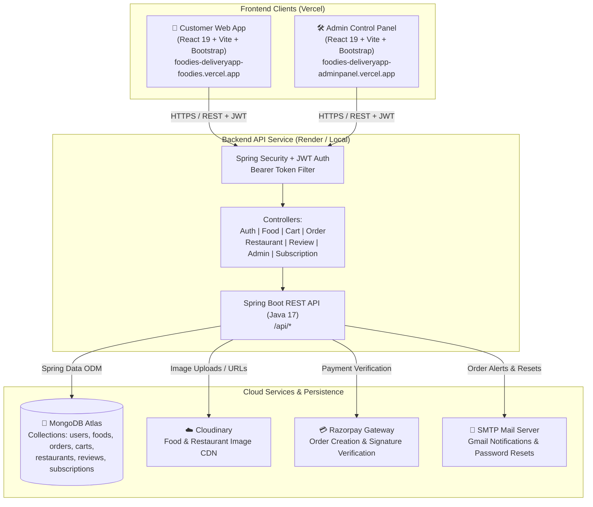

# 🍽️ Foodies - Full-Stack Food Delivery & Multi-Restaurant Platform

[](https://www.oracle.com/java/)
[](https://spring.io/projects/spring-boot)
[](https://react.dev/)
[](https://vitejs.dev/)
[](https://www.mongodb.com/)
[](https://razorpay.com/)
[](https://cloudinary.com/)
[](https://vercel.com/)
[](https://render.com/)

> **Foodies** is an enterprise-grade, end-to-end food delivery and multi-restaurant management web ecosystem. The platform includes a responsive **Customer Web Application**, an intuitive **Admin Control Panel**, and a high-performance **Spring Boot REST API** backed by **MongoDB Atlas**, **Razorpay payment processing**, and **Cloudinary asset storage**.

---

## 🌐 Live Deployments

| Component | Platform | Live URL |
| :--- | :--- | :--- |
| 🍔 **Customer Web Application** | **Vercel** | [https://foodies-deliveryapp-foodies.vercel.app/](https://foodies-deliveryapp-foodies.vercel.app/) |
| 🛠️ **Admin Management Panel** | **Vercel** | [https://foodies-deliveryapp-adminpanel.vercel.app/](https://foodies-deliveryapp-adminpanel.vercel.app/) |
| 📁 **GitHub Source Repository** | **GitHub** | [https://github.com/jhansi-0110/foodies-deliveryApp](https://github.com/jhansi-0110/foodies-deliveryApp) |

---

## 📑 Table of Contents

- [System Architecture](#-system-architecture)
- [Key Features](#-key-features)
  - [1. Customer Web Application (`foodies`)](#1-customer-web-application-foodies)
  - [2. Admin Control Panel (`adminpanel`)](#2-admin-control-panel-adminpanel)
  - [3. Backend REST Engine (`foodapi`)](#3-backend-rest-engine-foodapi)
- [Tech Stack Overview](#-tech-stack-overview)
- [Repository Structure](#-repository-structure)
- [Database Schema (MongoDB)](#-database-schema-mongodb)
- [Environment Variables](#-environment-variables)
- [Local Setup & Installation](#-local-setup--installation)
  - [1. Prerequisites](#1-prerequisites)
  - [2. Backend Setup (`foodapi`)](#2-backend-setup-foodapi)
  - [3. Customer App Setup (`foodies`)](#3-customer-app-setup-foodies)
  - [4. Admin Panel Setup (`adminpanel`)](#4-admin-panel-setup-adminpanel)
- [API Endpoints Reference](#-api-endpoints-reference)
- [Payment & Cloud Integrations](#-payment--cloud-integrations)
- [Deployment Guide](#-deployment-guide)
- [Author & Credits](#-author--credits)

---

## 🏗️ System Architecture



---

## ✨ Key Features

### 1. Customer Web Application (`foodies`)
- **Interactive Menu & Categories**: Browse popular cuisines including Biryani, Burgers, Pizzas, Rolls, Pastas, Salads, Desserts, Ice Cream, and Beverages.
- **Restaurant Showcase & Profiles**: Discover partner restaurants, check working hours, and view restaurant-specific menus.
- **Smart Cart System**: Real-time cart state management with instant quantity adjustment, subtotal calculations, packaging charges, and delivery fee computation.
- **Razorpay Checkout**: Seamless online payments supporting UPI, Cards, Net Banking, and Wallets in both Test and Live environments.
- **Live Order Tracking**: Order status progression (`Food Processing` ➔ `Out for Delivery` ➔ `Delivered`).
- **Order History (`/myorders`)**: Access previous orders with detailed breakdowns of items, amounts, transaction status, and timestamps.
- **Customer Reviews & Ratings**: Submit ratings and feedback for food items and partner restaurants.
- **Meal Subscriptions**: Subscribe to periodic daily meal plans.
- **Authentication & Security**: Register, Login, JWT session storage in local storage, automated password reset with secure email verification tokens.
- **Responsive Design**: Optimized for smartphones, tablets, and desktop displays using Bootstrap 5 and modern CSS animations.

---

### 2. Admin Control Panel (`adminpanel`)
- **Executive Analytics Dashboard**: Instant overview of system health:
  - Total Revenue Generated
  - Total Orders Count & Breakdown
  - Active Registered Users Count
  - Total Food Items & Restaurant Count
- **Menu & Food Management**:
  - Add new dishes with title, description, category, price, and instant image upload to Cloudinary.
  - Toggle food availability in real time.
  - Edit dish details or remove out-of-stock items.
- **Restaurant Partner Management**:
  - Review and onboard new restaurant partners.
  - Approve or decline partner registration requests.
  - Toggle operational status (Open / Closed) and active listings.
- **Live Order Management**:
  - Monitor orders across all restaurants.
  - Update status in real-time (`Food Processing`, `Out for Delivery`, `Delivered`).
- **User & Subscription Moderation**:
  - View registered customer profiles.
  - Enable/disable user accounts.
  - Review meal subscription enrollments.
- **Review Moderation**: Inspect customer ratings and reviews to maintain service quality.

---

### 3. Backend REST Engine (`foodapi`)
- **Stateless JWT Security**: Spring Security filter intercepting requests, parsing Bearer tokens, and validating user and admin claims.
- **Cloudinary Image Pipeline**: Multipart file processing directly uploaded to Cloudinary, storing secured CDN URLs in MongoDB.
- **Payment Verification Engine**: Server-side validation of `razorpay_order_id`, `razorpay_payment_id`, and HMAC SHA-256 signature verification.
- **Automated Email Notifications**: Built-in `JavaMailSender` service for password reset links and order notifications.
- **MongoDB Atlas Integration**: Spring Data Mongo repositories with indexed schemas for rapid querying and flexible schema evolution.

---

## 💻 Tech Stack Overview

| Layer | Technologies Used | Description |
| :--- | :--- | :--- |
| **Customer Frontend** | React 19, Vite, Bootstrap 5, Bootstrap Icons, Axios, React Router 7, React-Toastify | Client-facing e-commerce food delivery app |
| **Admin Frontend** | React 19, Vite, Bootstrap 5, Bootstrap Icons, Axios, React Router 7, React-Toastify | Management dashboard for administrators and restaurant managers |
| **Backend API** | Java 17, Spring Boot 4, Spring Web MVC, Spring Security, Spring Validation, Lombok | Enterprise RESTful API services |
| **Authentication** | JSON Web Tokens (`jjwt-api`, `jjwt-impl`, `jjwt-jackson` 0.12.6) | Stateless token-based auth with role authorization |
| **Database** | MongoDB Atlas, Spring Data MongoDB | Cloud NoSQL database storing users, orders, menus, and carts |
| **Media Storage** | Cloudinary Java SDK & React SDK | Cloud storage for food and restaurant cover images |
| **Payment Gateway** | Razorpay SDK (`razorpay-java` 1.4.8) | Multi-channel payment gateway |
| **Email Service** | Spring Boot Starter Mail (SMTP Gmail) | Transactional emails and authentication verification |
| **Deployment & Hosting** | Vercel (Frontends) + Render (Backend API) | Continuous deployment via GitHub |

---

## 📂 Repository Structure

```
food delivery app/
├── .github/                       # GitHub workflow and CI/CD configurations
├── render.env                     # Sample backend environment configuration for Render
├── README.md                      # Complete project documentation
│
├── foodapi/                       # 🟢 Spring Boot Backend API
│   ├── src/
│   │   ├── main/
│   │   │   ├── java/in/jhansi/foodapi/
│   │   │   │   ├── controller/    # REST Controllers (Auth, Food, Cart, Order, Admin, etc.)
│   │   │   │   ├── entity/        # MongoDB Document Entities (User, Food, Order, Cart, etc.)
│   │   │   │   ├── repository/    # Spring Data Mongo Repositories
│   │   │   │   ├── service/       # Business logic implementations & Interfaces
│   │   │   │   ├── security/      # JWT Filter, Token Provider, SecurityFilterChain
│   │   │   │   ├── config/        # Cloudinary, WebMvc CORS, and Razorpay configurations
│   │   │   │   └── FoodapiApplication.java
│   │   │   └── resources/
│   │   │       └── application.properties # Server port, DB URI, Cloudinary, Razorpay keys
│   │   └── test/                  # Unit and integration test suites
│   └── pom.xml                    # Maven configuration and dependencies
│
├── foodies/                       # 🍔 Customer Web Application (React + Vite)
│   ├── public/                    # Static favicon and public assets
│   ├── src/
│   │   ├── assets/                # Food category banners, logos, and icons
│   │   ├── components/            # Reusable UI widgets (Header, MenuBar, FoodDisplay, CartSummary)
│   │   ├── pages/                 # Route pages (Home, Cart, PlaceOrder, MyOrders, Login, Register)
│   │   ├── services/              # Axios API service callers (Auth, Food, Cart, Order)
│   │   ├── context/               # Global StoreContext for user session and shopping cart
│   │   ├── config.js              # Base API URL endpoint configuration
│   │   ├── App.jsx                # Application routes and layout
│   │   └── main.jsx               # React entry point
│   ├── package.json
│   └── vite.config.js
│
└── adminpanel/                    # 🛠️ Admin Management Panel (React + Vite)
    ├── public/                    # Admin assets
    ├── src/
    │   ├── assets/                # Admin icons and illustrations
    │   ├── components/            # Sidebar, Top MenuBar, Shared Icons
    │   ├── pages/                 # Dashboard, AddFood, ListFood, Orders, Restaurants, Users
    │   ├── services/              # Admin Axios API calls with JWT Bearer Interceptors
    │   ├── App.jsx                # Admin route definitions
    │   └── main.jsx               # Admin entry point
    ├── package.json
    └── vite.config.js
```

---

## 🗄️ Database Schema (MongoDB)

| Collection | Key Fields | Description |
| :--- | :--- | :--- |
| **`users`** | `_id`, `name`, `email`, `password`, `role`, `phoneNumber`, `address`, `status`, `resetToken` | Registered customer and administrator accounts |
| **`foods`** | `_id`, `name`, `description`, `price`, `category`, `imageUrl`, `restaurantId`, `isAvailable` | Catalog of dishes with Cloudinary image URLs |
| **`carts`** | `_id`, `userId`, `items: [{ foodId, quantity, price }]`, `updatedAt` | Active persistent shopping carts per customer |
| **`orders`** | `_id`, `userId`, `items`, `totalAmount`, `status`, `paymentMethod`, `paymentStatus`, `razorpayOrderId`, `deliveryAddress`, `createdAt` | Customer orders and live tracking status |
| **`restaurants`**| `_id`, `name`, `address`, `phone`, `cuisineType`, `isOpen`, `isApproved`, `ownerId` | Partner restaurants and operating status |
| **`reviews`** | `_id`, `userId`, `foodId`, `restaurantId`, `rating`, `comment`, `createdAt` | Customer reviews and star ratings |
| **`subscriptions`**| `_id`, `userId`, `planType`, `startDate`, `endDate`, `status`, `price` | Recurring daily meal subscriptions |
| **`notifications`**| `_id`, `userId`, `title`, `message`, `isRead`, `createdAt` | In-app alerts for orders and promos |

---

## 🔑 Environment Variables

### Backend (`foodapi/src/main/resources/application.properties` or `render.env`)

```properties
# Server
PORT=8080

# MongoDB Atlas Connection URI
SPRING_DATA_MONGODB_URI=mongodb+srv://<username>:<password>@cluster0.nvkr5kn.mongodb.net/foodies?retryWrites=true&w=majority

# Cloudinary Storage
CLOUDINARY_CLOUD_NAME=your_cloudinary_cloud_name
CLOUDINARY_API_KEY=your_cloudinary_api_key
CLOUDINARY_API_SECRET=your_cloudinary_api_secret

# Razorpay Payment Gateway
RAZORPAY_KEY_ID=rzp_test_your_key_id
RAZORPAY_KEY_SECRET=your_razorpay_secret_key

# JWT Token Secret
JWT_SECRET=your_base64_or_hex_encoded_jwt_secret_key_minimum_256_bits

# SMTP Mail Notification Configuration (Optional for Gmail)
SPRING_MAIL_HOST=smtp.gmail.com
SPRING_MAIL_PORT=587
SPRING_MAIL_USERNAME=your_email@gmail.com
SPRING_MAIL_PASSWORD=your_gmail_app_password
```

### Customer Frontend (`foodies/.env`)

```env
# URL pointing to your backend REST API
VITE_API_URL=https://your-backend-service.onrender.com/api
# Or for local testing:
# VITE_API_URL=http://localhost:8080/api

# Razorpay Key for Checkout (Must match backend key ID)
VITE_RAZORPAY_KEY_ID=rzp_test_your_key_id
```

### Admin Panel (`adminpanel/.env`)

```env
# URL pointing to your backend REST API
VITE_API_URL=https://your-backend-service.onrender.com/api
# Or for local testing:
# VITE_API_URL=http://localhost:8080/api
```

---

## 🚀 Local Setup & Installation

### 1. Prerequisites
- **Java Development Kit (JDK)**: Version 17 or higher (`java -version`)
- **Apache Maven**: Version 3.8+ (`mvn -version`)
- **Node.js**: Version 18+ and **npm** (`node -v`, `npm -v`)
- **MongoDB Atlas** account (or local MongoDB Community Edition running on port 27017)
- **Cloudinary** account (free tier works great)
- **Razorpay** test account

---

### 2. Backend Setup (`foodapi`)

1. Open your terminal and navigate to the backend folder:
   ```bash
   cd "food delivery app/foodapi"
   ```

2. Configure environment credentials in `src/main/resources/application.properties` (or set the system environment variables listed in [Environment Variables](#-environment-variables)).

3. Build and launch the Spring Boot application:
   ```bash
   # Clean and build the package
   mvn clean install -DskipTests

   # Run Spring Boot
   mvn spring-boot:run
   ```

4. The backend server will start at:
   ```
   http://localhost:8080
   ```

---

### 3. Customer App Setup (`foodies`)

1. Navigate to the customer app directory:
   ```bash
   cd "../foodies"
   ```

2. Create a `.env` file or verify `src/config.js`:
   ```bash
   # Set API to local backend
   VITE_API_URL=http://localhost:8080/api
   ```

3. Install project dependencies:
   ```bash
   npm install
   ```

4. Launch the local development server:
   ```bash
   npm run dev
   ```

5. Access the customer store in your browser:
   ```
   http://localhost:5173
   ```

---

### 4. Admin Panel Setup (`adminpanel`)

1. Navigate to the admin panel directory:
   ```bash
   cd "../adminpanel"
   ```

2. Create a `.env` file:
   ```bash
   VITE_API_URL=http://localhost:8080/api
   ```

3. Install dependencies:
   ```bash
   npm install
   ```

4. Launch the admin development server:
   ```bash
   npm run dev
   ```

5. Access the admin dashboard in your browser (usually port 5174 if 5173 is occupied):
   ```
   http://localhost:5174
   ```

---

## 🔌 API Endpoints Reference

### 🔐 Authentication (`/api`)
| Method | Endpoint | Description | Auth Required |
| :--- | :--- | :--- | :--- |
| `POST` | `/api/register` | Register a new user account | ❌ No |
| `POST` | `/api/login` | Login and receive JWT access token | ❌ No |
| `GET` | `/api/me` | Fetch authenticated user profile | 🔒 Yes (Bearer) |
| `POST` | `/api/forgot-password` | Send password reset token to email | ❌ No |
| `POST` | `/api/verify-reset-token`| Validate password reset token | ❌ No |
| `POST` | `/api/reset-password` | Update password using reset token | ❌ No |

### 🍕 Food Items (`/api/foods`)
| Method | Endpoint | Description | Auth Required |
| :--- | :--- | :--- | :--- |
| `GET` | `/api/foods` | Retrieve list of all available food items | ❌ No |
| `GET` | `/api/foods/{id}` | Get food item details by ID | ❌ No |
| `GET` | `/api/foods/restaurant/{restaurantId}` | Get foods affiliated with a restaurant | ❌ No |
| `POST` | `/api/foods` | Add new food item (with image upload) | 🔒 Yes (Admin) |
| `PUT` | `/api/foods/{id}` | Update existing food item | 🔒 Yes (Admin) |
| `PATCH` | `/api/foods/{id}/availability` | Toggle food item availability | 🔒 Yes (Admin) |
| `DELETE`| `/api/foods/{id}` | Delete food item from database | 🔒 Yes (Admin) |

### 🛒 Shopping Cart (`/api/cart`)
| Method | Endpoint | Description | Auth Required |
| :--- | :--- | :--- | :--- |
| `GET` | `/api/cart` | Get current user's shopping cart | 🔒 Yes |
| `POST` | `/api/cart` | Add / increment food item in cart | 🔒 Yes |
| `POST` | `/api/cart/remove` | Decrement / remove item from cart | 🔒 Yes |
| `DELETE`| `/api/cart` | Empty all items from user cart | 🔒 Yes |

### 📦 Orders & Payments (`/api/orders`)
| Method | Endpoint | Description | Auth Required |
| :--- | :--- | :--- | :--- |
| `POST` | `/api/orders/create` | Place order & create Razorpay transaction | 🔒 Yes |
| `POST` | `/api/orders/verify` | Verify Razorpay payment signature | 🔒 Yes |
| `GET` | `/api/orders` | Fetch orders placed by authenticated user | 🔒 Yes |
| `GET` | `/api/orders/all` | Fetch all orders across platform | 🔒 Yes (Admin) |
| `GET` | `/api/orders/{orderId}` | Get detailed breakdown of specific order | 🔒 Yes |
| `PATCH` | `/api/orders/status/{orderId}` | Update status (`Preparing`, `Out for Delivery`, `Delivered`) | 🔒 Yes (Admin) |
| `DELETE`| `/api/orders/{orderId}` | Cancel / remove order | 🔒 Yes |

### 📊 Admin Operations (`/api/admin`)
| Method | Endpoint | Description | Auth Required |
| :--- | :--- | :--- | :--- |
| `GET` | `/api/admin/stats` | Dashboard metrics (Revenue, Orders, Users, Foods) | 🔒 Yes (Admin) |
| `GET` | `/api/admin/users` | Retrieve all registered users | 🔒 Yes (Admin) |
| `PATCH` | `/api/admin/users/{id}/status`| Toggle user active / suspended status | 🔒 Yes (Admin) |
| `DELETE`| `/api/admin/users/{id}` | Delete user account | 🔒 Yes (Admin) |

### 🏢 Restaurants (`/api/restaurants`)
| Method | Endpoint | Description | Auth Required |
| :--- | :--- | :--- | :--- |
| `GET` | `/api/restaurants` | List all verified and approved restaurants | ❌ No |
| `GET` | `/api/restaurants/all` | List all restaurants including pending | 🔒 Yes (Admin) |
| `POST` | `/api/restaurants` | Register new restaurant partner | 🔒 Yes |
| `PATCH` | `/api/restaurants/{id}/approve` | Approve restaurant onboarding | 🔒 Yes (Admin) |
| `PATCH` | `/api/restaurants/{id}/toggle-open` | Toggle restaurant open/closed status | 🔒 Yes (Partner) |

---

## 💳 Payment & Cloud Integrations

### Razorpay Payment Flow
1. User clicks **"Proceed to Payment"** on the checkout page.
2. The frontend calls `POST /api/orders/create`.
3. The Spring Boot backend uses `razorpay-java` to generate a Razorpay Order ID.
4. The client receives `razorpay_order_id` and mounts the Razorpay checkout modal with test credentials.
5. On successful checkout, Razorpay issues a payment signature.
6. The client sends `{ razorpay_order_id, razorpay_payment_id, razorpay_signature }` to `POST /api/orders/verify`.
7. The backend computes the HMAC SHA-256 signature and marks the order as **Paid**.

### Cloudinary Asset Management
- When administrators add new food items via the admin portal, the multipart file is transferred to Cloudinary via `Cloudinary.uploader().upload()`.
- The returned secure URL is stored in the MongoDB `foods` collection, ensuring ultra-fast CDN delivery without straining the backend host.

---

## 🌐 Deployment Guide

### Deploying Frontend to Vercel
1. Push your code to GitHub.
2. Log in to [Vercel](https://vercel.com/) and click **"Add New Project"**.
3. Import `https://github.com/jhansi-0110/foodies-deliveryApp`.
4. Configure two separate deployments:
   - **Customer App**:
     - Root Directory: `foodies`
     - Framework Preset: `Vite`
     - Environment Variables: `VITE_API_URL=<YOUR_RENDER_BACKEND_URL>/api`
   - **Admin Panel**:
     - Root Directory: `adminpanel`
     - Framework Preset: `Vite`
     - Environment Variables: `VITE_API_URL=<YOUR_RENDER_BACKEND_URL>/api`
5. Click **Deploy**.

### Deploying Backend to Render
1. Create a **Web Service** on [Render](https://render.com/).
2. Connect your GitHub repository.
3. Configure the service:
   - Root Directory: `foodapi`
   - Environment: `Java` / `Docker` (or Maven Build: `mvn clean package -DskipTests`, Start Command: `java -jar target/foodapi-0.0.1-SNAPSHOT.jar`)
4. In the **Environment Variables** tab, paste the variables from `render.env`.
5. Deploy and copy your live Render URL into your Vercel frontend configurations.

---

## 👩‍💻 Author & Credits

Developed with ❤️ by **Jhansi**
- GitHub: [@jhansi-0110](https://github.com/jhansi-0110)
- Repository: [foodies-deliveryApp](https://github.com/jhansi-0110/foodies-deliveryApp)

---

## 📄 License
This project is licensed under the MIT License - feel free to use it for educational and portfolio purposes.
